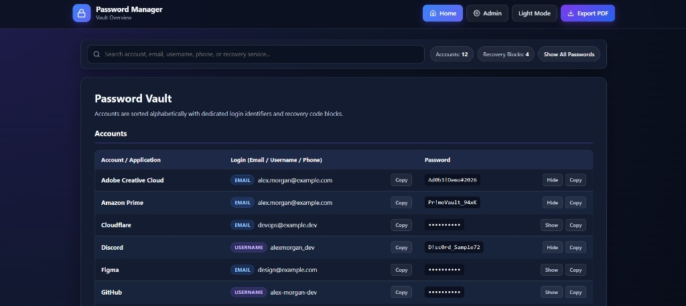
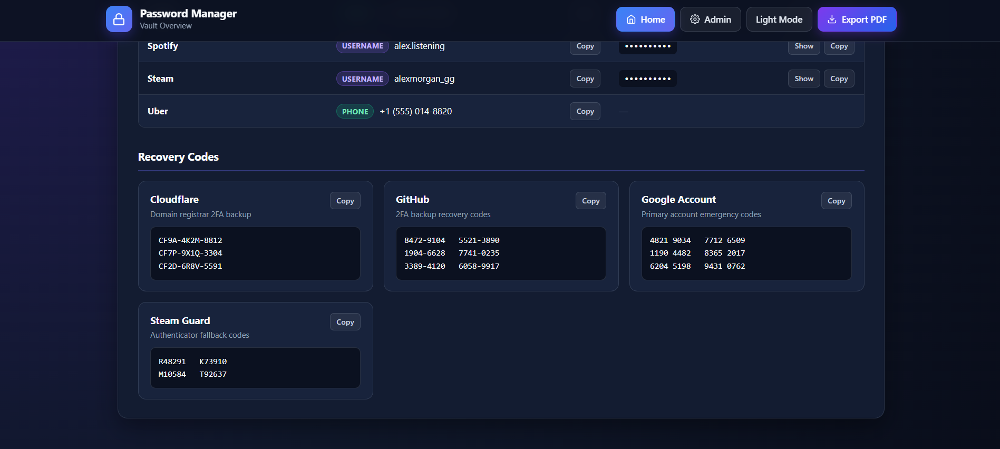
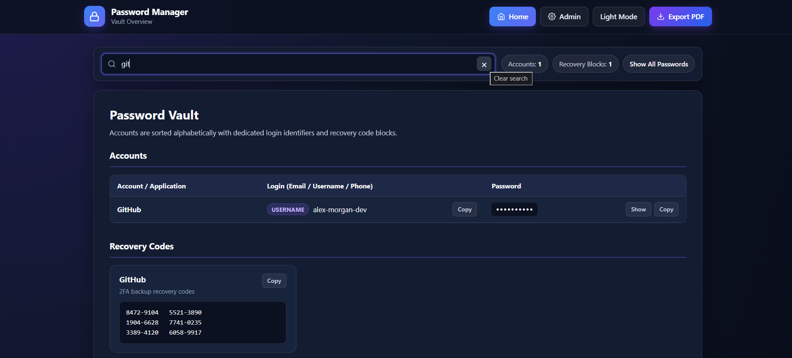
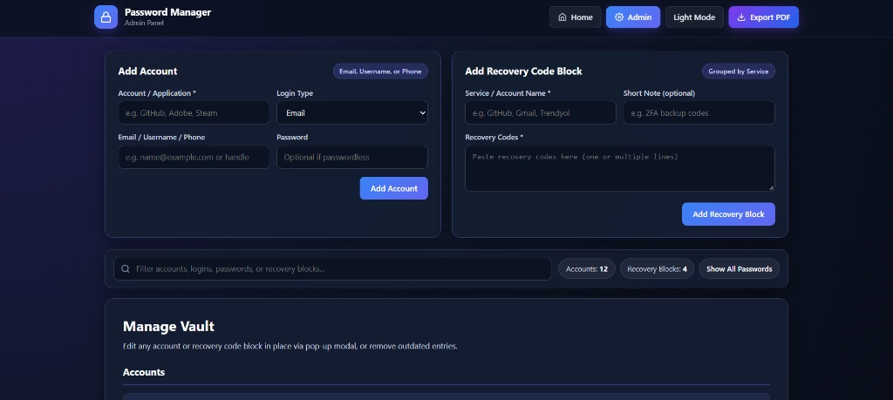
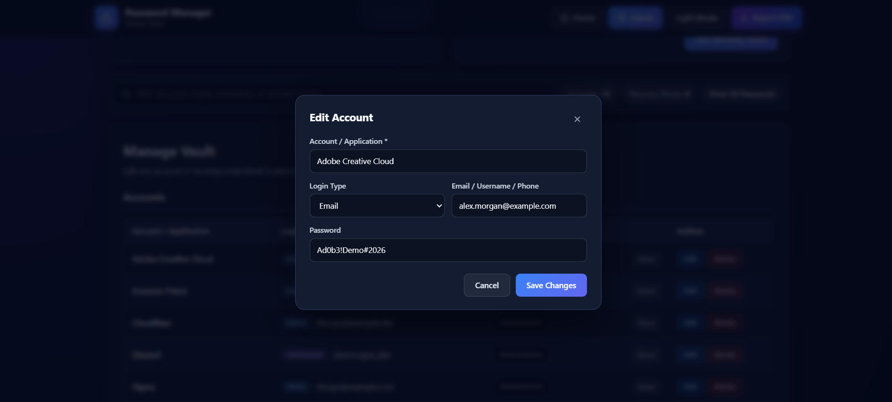

# Password Manager

A clean, responsive, local-first ASP.NET Core MVC (.NET 10) vault for organizing account credentials (application/site name, login identifier by email, username, or phone, and password) alongside structured recovery code blocks, powered by Entity Framework Core, SQL Server, and QuestPDF.

## Screenshots

### Vault Overview — Accounts Table


### Recovery Code Blocks


### Instant Live Search


### Admin Panel


### In-Place Edit Modal


## Features

- **Structured Account Vault (`Home`)**: View all saved accounts alphabetically with dedicated columns for **Account / App**, **Login Identifier** (Email, Username, or Phone), and **Password** (masked by default with quick reveal and one-click copy).
- **Recovery Code Blocks**: Store multi-line backup and recovery codes grouped by service name (e.g., GitHub, Gmail, Steam) in clean, scannable blocks with one-click copy.
- **Instant Live Search**: Real-time filtering across both accounts and recovery code blocks with keyboard shortcut (`Ctrl+K` / `Cmd+K`) and a custom clear-search (`×`) button.
- **Local Management Panel (`Admin`)**: Localhost-restricted management panel for adding accounts and recovery code blocks, editing entries via in-place pop-up modals, and deleting records safely.
- **Light & Dark PDF Export**: Generate a clean A4 PDF archive in either **Light** or **Dark** theme via QuestPDF.
- **Responsive & Theme-Aware**: Persistent dark and light UI themes with zero flash on load, responsive across desktop, tablet, and mobile viewports.

## Tech Stack

- **Framework**: ASP.NET Core MVC (.NET 10)
- **ORM & Database**: Entity Framework Core 10 + SQL Server
- **PDF Generation**: QuestPDF (Community License)
- **Frontend**: Razor Views, vanilla JavaScript, custom CSS variables

## Getting Started

### Prerequisites

- [.NET 10 SDK](https://dotnet.microsoft.com/download)
- SQL Server / SQL Server Express / LocalDB

### Configuration

1. Clone the repository:
   ```bash
   git clone https://github.com/02-fraw/PasswordManager.git
   cd PasswordManager
   ```

2. Configure your local database connection string with .NET User Secrets (keeps `appsettings.json` clean):
   ```bash
   dotnet user-secrets init --project PasswordManager
   dotnet user-secrets set "ConnectionStrings:DefaultConnection" "Server=.\SQLEXPRESS;Database=PasswordManagerDb;Trusted_Connection=True;MultipleActiveResultSets=true;Encrypt=True;TrustServerCertificate=True" --project PasswordManager
   ```

3. Apply Entity Framework Core migrations:
   ```bash
   dotnet ef database update --project PasswordManager
   ```
   *(Or run `Update-Database` in Visual Studio's Package Manager Console.)*

4. Run the application:
   ```bash
   dotnet run --project PasswordManager
   ```

## Security Practices

- Localhost-only access guard (`LocalOnlyAdminFilter`) restricting the Admin panel to local requests.
- Automatic anti-forgery token validation (`[AutoValidateAntiforgeryToken]`) with `HttpOnly` and `SameSite=Strict` cookies.
- Parameterized EF Core LINQ queries and strict ViewModel binding.
- Strict HTTP security headers (`Content-Security-Policy` with `script-src 'self'`, `X-Content-Type-Options`, `X-Frame-Options`, `Referrer-Policy`, `Permissions-Policy`, `Cross-Origin-Opener-Policy`).
- No hardcoded personal credentials or real SQL Server connection strings in the repository.
